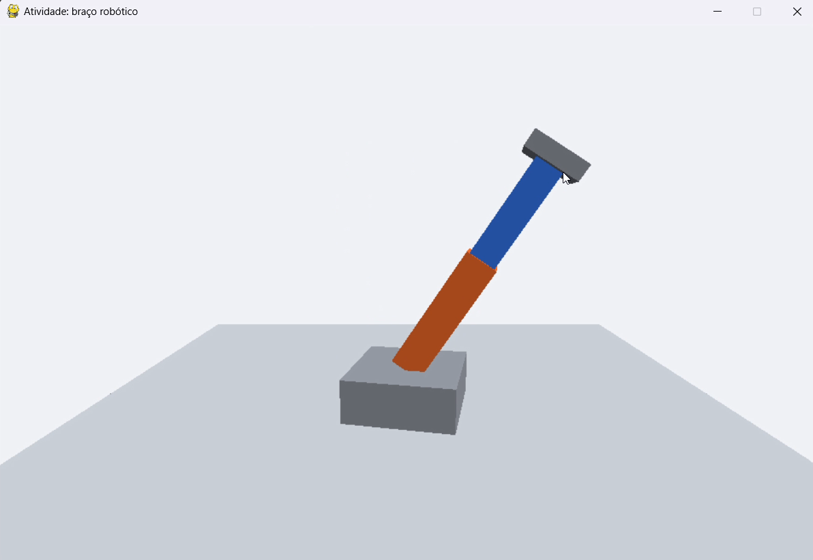

# Atividade 2 — Braço Robótico

**Disciplina:** Computação Gráfica  
**Atividade:** Braço Robótico — Grafo de cena  
**Integrante:** João Alberto Madeira Soares Filho  
**Modalidade:** Individual

## Descrição

Desenvolvi um braço robótico tridimensional a partir de uma hierarquia de objetos. A base cinza sustenta o ombro, que controla o braço laranja; na extremidade do braço existe um pivô para o cotovelo, ao qual estão ligados o antebraço azul e a garra cinza. A hierarquia faz com que as partes acompanhem os movimentos das articulações.

## Resposta da questão conceitual

Os pivôs foram necessários porque as caixas são criadas com seu centro na origem local. Ao girar diretamente uma caixa, ela tende a girar ao redor do próprio centro, e não no ponto onde ficaria a articulação. O `Object3D` funciona como referência para posicionar o ombro e o cotovelo e realizar a rotação nesses locais. Além disso, por serem objetos filhos, o antebraço e a garra acompanham os movimentos das partes anteriores.

## Controles

- **A / D:** giram a base no eixo Y.
- **W / S:** movimentam o ombro no eixo Z.
- **I / K:** movimentam o cotovelo no eixo Z.
- **P:** salva a captura de tela.
- **Esc:** fecha o programa.

## Execução

Abra um terminal dentro desta pasta `alunos/`:

```powershell
py -3.12 -m venv .venv
.\.venv\Scripts\python.exe -m pip install -r requirements.txt
.\.venv\Scripts\python.exe atividade_braco.py
```

## Captura do resultado


