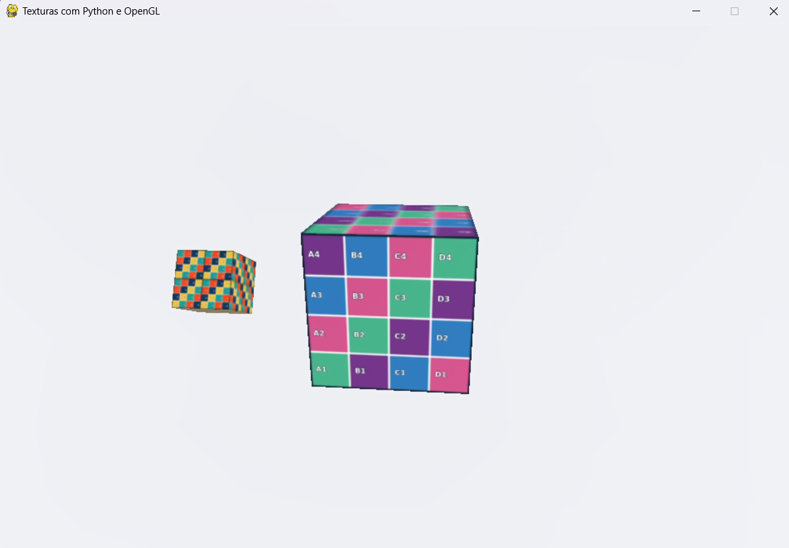

# Atividade 3 — Cubo com Satélite Texturizado

**Disciplina:** Computação Gráfica  
**Atividade:** Cubo com Satélite Texturizado — Texturas  
**Integrantes:** João Alberto Madeira Soares Filho e **[NOME COMPLETO DO SEGUNDO INTEGRANTE]**  

## Descrição da solução

Nesta atividade, aplicamos a textura `mosaico.png` ao cubo principal. Criamos um segundo cubo, menor, com a textura `grade_uv.png` configurada para se repetir duas vezes em cada direção. Esse satélite foi adicionado como filho do cubo principal, a 1,3 unidade de distância e com escala 0,4, de modo que acompanhe a rotação do cubo maior. Também implementamos a rotação própria do satélite no eixo X e os controles de velocidade do cubo principal.

## Resposta da questão conceitual

As coordenadas UV indicam como uma imagem 2D será distribuída sobre a superfície de um objeto 3D. A coordenada U representa a direção horizontal da textura, e V representa a direção vertical. Quando configuramos `repeatUV = [2,2]`, a imagem passa a se repetir duas vezes na horizontal e duas vezes na vertical, formando quatro repetições em cada face, sem a necessidade de alterar o arquivo original da textura.

## Como executar

Abra o terminal nesta pasta `alunos` e execute:

```powershell
py -3.12 -m venv .venv
.\.venv\Scripts\python.exe -m pip install -r requirements.txt
.\.venv\Scripts\python.exe atividade_cubo.py
```

**Controles:** ↑ aumenta a velocidade; ↓ diminui; S salva a captura; Esc fecha.

## Captura de tela



> A imagem deve ser capturada durante a execução, pressionando S.
