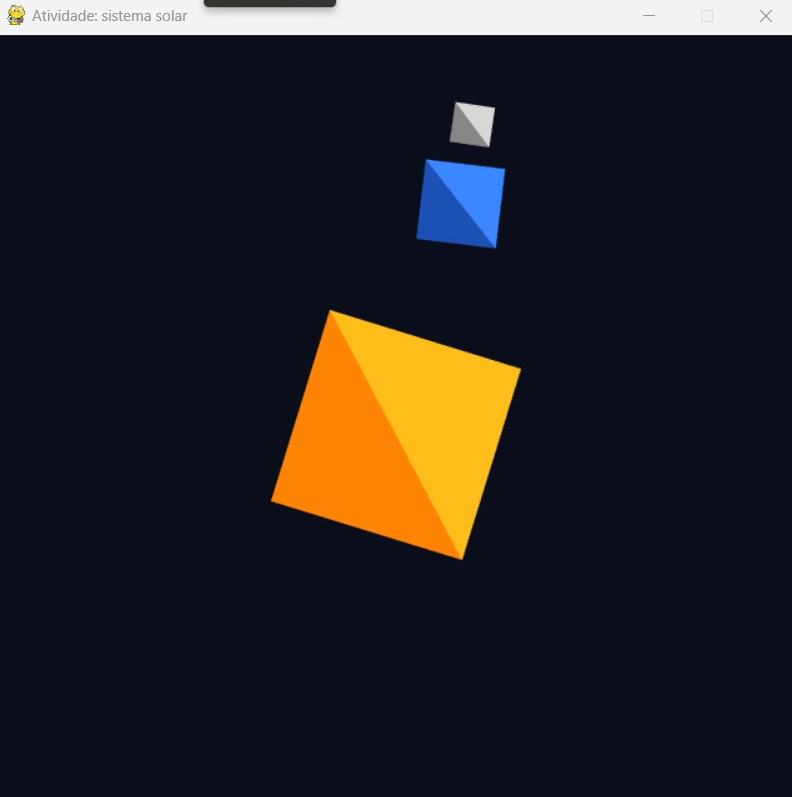

# Atividade 1 — Mini Sistema Solar

**Disciplina:** Computação Gráfica  
**Atividade:** Mini Sistema Solar — Transformações geométricas  
**Integrante:** João Alberto Madeira Soares Filho  
**Modalidade:** Individual

## Descrição

Nesta atividade, implementei um mini sistema solar em 2D combinando matrizes de rotação, translação e escala. O Sol gira em torno do próprio centro, o planeta orbita o Sol a uma distância de `0.6` e também apresenta rotação própria. A Lua orbita o planeta a uma distância de `0.2`, acompanhando seu movimento. As animações utilizam `deltaTime`, e as setas permitem alterar a velocidade da órbita sem deixá-la negativa.

## Resposta da questão conceitual

A órbita é construída com `R @ T` porque a translação afasta o planeta da origem e a rotação faz esse deslocamento circular ao redor do Sol. Como as operações são aplicadas da direita para a esquerda, a translação acontece primeiro. A rotação própria do planeta fica à direita da translação para acontecer no sistema de coordenadas local do objeto. Dessa maneira, ele gira sobre si mesmo e, ao mesmo tempo, mantém sua distância orbital.

## Controles

- **↑ / ↓:** aumentam e diminuem a velocidade da órbita.
- **P:** salva a captura de tela.
- **Esc:** fecha o programa.

## Execução

Abra um terminal dentro desta pasta `alunos/`:

```powershell
py -3.12 -m venv .venv
.\.venv\Scripts\python.exe -m pip install -r requirements.txt
.\.venv\Scripts\python.exe atividade_sistema_solar.py
```

## Captura do resultado


